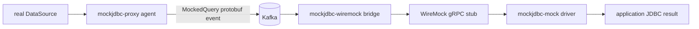

**MockJDBC is a record/replay toolkit for debugging and testing JDBC-based applications.** It captures real SQL activity from a running application and lets you replay it later as a drop-in JDBC driver, without a live database.

:::caution Status: pre-release / beta preparation
MockJDBC is a **debugging and testing tool**. It is **not intended for production deployment**, and its JDBC coverage is intentionally partial. Review [Known limitations](reference/known-limitations.md) before adopting it.
:::

## Why MockJDBC

Testing or debugging code that talks to a database usually means either running a real database in every environment, or hand-writing mocks for every query shape you care about. MockJDBC offers a third option: **capture what your application actually does against JDBC, then replay it deterministically** — in CI, in a debugging session, or in an isolated environment with no database at all.

## How it works

1. **Record** — `mockjdbc-proxy` instruments a `DataSource` and publishes captured query/parameter/result activity as `MockedQuery` events. See [Capturing with the proxy agent](getting-started/capturing-with-the-proxy-agent.md).
2. **Bridge** — [`mockjdbc-wiremock`](guides/wiremock-bridge.md) consumes those events from Kafka and registers them as deterministic WireMock stubs.
3. **Replay** — [`mockjdbc-mock`](getting-started/replaying-with-the-mock-driver.md) is a real `java.sql.Driver` (`jdbc:mock://...`) that resolves queries against those stubs over gRPC, so your application code runs unmodified against a replayed backend.

## Modules

| Module | Role |
|---|---|
| `mockjdbc-proto` | Protobuf/gRPC contracts shared by every module. |
| `mockjdbc-proxy` | Java agent that captures JDBC activity and publishes `MockedQuery` events. |
| `mockjdbc-wiremock` | WireMock extension that turns captured events into stub mappings. |
| `mockjdbc-mock` | The replay-side JDBC driver (`jdbc:mock://...`). |
| `mockjdbc-spring-users` | A runnable Spring Boot sample demonstrating all three profiles (H2, proxy capture, mock replay). |

## Where to go next

- New to the project? Start with [Installation](getting-started/installation.md).
- Want to see the full flow end to end? Follow the [record-to-replay tutorial](guides/end-to-end-tutorial.md).
- Wondering what's supported? Check the [supported JDBC surface](reference/supported-jdbc-surface.md) and [known limitations](reference/known-limitations.md).
